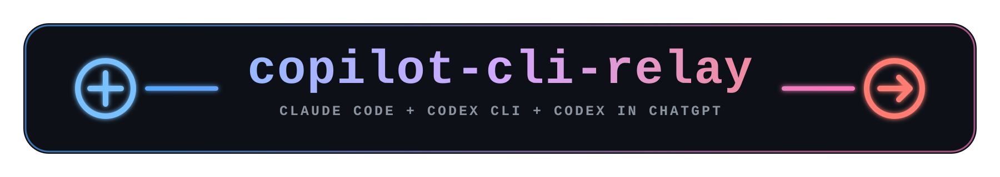

<h1 align="center">
  
</h1>

<p align="center">
  <a href="https://www.anthropic.com/claude"> Claude Code</a>
  &nbsp;·&nbsp;
  <a href="https://github.com/features/copilot"> GitHub Copilot</a>
  &nbsp;·&nbsp;
  <a href="https://github.com/openai/codex"><picture><source media="(prefers-color-scheme: dark)" srcset="assets/openai-logo-dark.svg"><source media="(prefers-color-scheme: light)" srcset="assets/openai-logo-light.svg"></picture> OpenAI Codex CLI</a>
  &nbsp;·&nbsp;
  <a href="https://learn.chatgpt.com/docs/app">ChatGPT desktop app (Codex)</a>
</p>

<p align="center">
  <em>A small Python reverse proxy for <strong>Claude Code</strong>, <strong>Codex CLI</strong>, and <strong>Codex in the ChatGPT desktop app</strong>, backed by <strong>GitHub Copilot</strong>. Native protocols, relay-managed authentication, no separate Anthropic or OpenAI API key.</em>
</p>

<p align="center">
  
  
  
  
  
</p>

<p align="center">
  <a href="https://www.anthropic.com/claude"></a>
  
  <a href="https://github.com/features/copilot"></a>
  
  <a href="https://github.com/openai/codex"></a>
</p>

---

> ## Disclaimer
>
> **Community-maintained, with project-supported client integrations.** This GitHub Copilot relay supports Claude Code, Codex CLI, and Windows Codex desktop integration within the [documented scope](#supported-clients-and-scope). It is **not affiliated with, endorsed by, or supported by Microsoft, GitHub, Anthropic, or OpenAI**.
>
> Project support means best-effort maintenance, regression tests, and documented setup and troubleshooting for tested combinations. There is no warranty, SLA, guaranteed response time, or guarantee of fitness for any purpose. APIs, headers, model availability, and tenant behavior on the upstream services can change at any time and break this proxy without notice.
>
> **Use at your own risk.** You are solely responsible for ensuring that your use of GitHub Copilot through this proxy complies with your Copilot subscription terms, your employer's acceptable-use policies, and any applicable laws. The authors and contributors accept **no liability** for account suspension, data loss, billing surprises, security incidents, or any other damages arising from use of this software. See [`LICENSE`](LICENSE) for the full no-warranty / no-liability terms.

---

A small Python reverse proxy that runs in Docker. Claude Code uses the Anthropic
Messages routes under `/claude/v1`. Codex CLI and local Codex chats in the ChatGPT
desktop app share the OpenAI Responses routes under `/codex/v1`. Both are
forwarded to GitHub Copilot's native endpoints, with compatibility rewrites but
**no conversion between Messages, Chat Completions, and Responses**.

## Supported clients and scope

The **Codex desktop integration** is a first-class, project-supported client path,
alongside Claude Code and Codex CLI. Support is bounded by the recorded
qualification and known limitations, not a claim that every app feature or
long-session workflow is production-qualified. The [desktop guide](docs/codex-desktop.md#product-name-and-support-boundary)
defines that boundary.

| Client or surface | Relay integration | Setup |
|---|---|---|
| Claude Code | Native Anthropic Messages | [Claude setup](#claude-setup) |
| Codex CLI | Native OpenAI Responses | [CLI setup](#codex-cli-setup) |
| ChatGPT desktop app (Codex mode) | Runs local Codex chats through GitHub Copilot. Tested on Windows. | [App setup](#chatgpt-desktop-app-setup-codex-on-windows) and [validation details](docs/codex-desktop.md#recorded-validation) |
| ChatGPT Chat, Work, voice, and other app services | Not configured or proxied by this integration | Separate app features, endpoints, and permissions |
| Codex cloud tasks | Not supported by this loopback deployment | Cloud execution cannot use this computer's `127.0.0.1` relay |

OpenAI's [current app documentation](https://learn.chatgpt.com/docs/app) describes
a unified ChatGPT desktop app containing Codex. This repo retains
`codex-desktop.ps1`, `docs/codex-desktop.md`, and existing provider IDs for
compatibility. "Codex Desktop" in older records means that Codex experience, not
support for all ChatGPT traffic. Worktree mode also runs locally, but has not
been separately qualified here. See the [glossary](GLOSSARY.md) for terminology
and [architecture](ARCHITECTURE.md) for implementation boundaries.

The [project review](docs/project-review-2026-10-18.md) records four inherited
runtime findings and their authorized fixes: truncation-safe diagnostics,
synthetic-summary validation, catalog-shape checks, and authoritative Claude
headers. Production source changes require a new validated image and container
recreation; restarting the old image does not apply source edits.
The [full-project review](docs/project-review-2026-10-26.md) records the later
promotion/hardening regression fixes and the distinction between reviewed source
and the deployed image.

## How it works

```text
+==============================+       +========================================+       +================================+
| Claude Code                  |       | copilot-cli-relay                      |       | GitHub Copilot                 |
| Anthropic Messages JSON/SSE  |       | 127.0.0.1:4141                         |       | Anthropic native endpoints     |
| POST /claude/v1/messages     | ====> | Claude route handlers                  | ====> | POST /v1/messages              |
| GET  /claude/v1/models       | <==== | build_claude_outbound_headers          | <==== | GET  /models                   |
+==============================+       |                                        |       +================================+
                                       | uvicorn + Starlette                    |
                                       | shared httpx AsyncClient, HTTP/2       |
                                       | proxy_shared streaming + passthrough   |
+==============================+       |                                        |       +================================+
| Codex CLI / ChatGPT app      |       | Codex route handlers                   |       | GitHub Copilot                 |
| (Codex, local)               |       |                                        |       |                                |
| OpenAI Responses JSON/SSE    |       | build_codex_outbound_headers           |       | Responses native endpoints     |
| POST /codex/v1/responses     | ====> | compact fallback, body cleanup         | ====> | POST /responses                |
| POST /codex/v1/responses/    | ====> |                                        | ====> | POST /responses/compact        |
| compact                      |       |                                        |       | or fallback to /responses      |
| GET  /codex/v1/models        | <==== |                                        | <==== | GET  /models                   |
+==============================+       +====================^===================+       +================================+
                                                            |
                                                            |
                                      .env: COPILOT_GITHUB_TOKEN
                                      extracted from Windows Credential Manager
```

| Client | Local relay routes | Upstream Copilot routes | Protocol |
|---|---|---|---|
| Claude Code | `POST /claude/v1/messages`<br>`GET /claude/v1/models` | `POST /v1/messages`<br>`GET /models` | Anthropic Messages JSON/SSE |
| Codex CLI and ChatGPT app (local Codex), including harness `/compact` | `POST /codex/v1/responses`<br>`GET /codex/v1/models` | `POST /responses`<br>`GET /models` | OpenAI Responses JSON/SSE |
| Legacy compact API, explicit callers only | `POST /codex/v1/responses/compact` | Tries `POST /responses/compact`; synthetic fallback on 404 requires explicit opt-in | OpenAI Responses JSON |

| Relay step | What happens |
|---|---|
| Auth | Reads `COPILOT_GITHUB_TOKEN` from the container environment. Compose loads it from `.env` when creating the container. |
| Header safety | Strips local client auth, cookies, host, content length, and hop-by-hop headers. |
| Protocol headers | Adds the Copilot bearer plus Claude-specific or Codex-specific headers. |
| Compatibility | Applies small route-specific body rewrites, then streams the native upstream response format back unchanged. |

The proxy keeps each client on its native protocol. Codex's CLI and app clients
share `/codex/v1/responses`; there is no extra desktop route or app patch. The
proxy replaces local dummy auth with the GitHub OAuth bearer, adds Copilot
headers, and forwards SSE incrementally. Keepalives are inserted only between
complete events. Use harness-managed `/compact` in either Codex client. Setup
helpers explicitly select local compaction rather than the standalone compact
endpoint. See [compaction setup and evidence](docs/compaction.md). The legacy API
route remains available for explicit callers; its synthetic fallback stays off.

Four things make this work cleanly:

1. The `copilot` CLI's OAuth token (in Windows Credential Manager) authenticates directly against `api.githubcopilot.com` — **no session-token exchange needed**.
2. Copilot exposes a native Anthropic Messages endpoint at `/v1/messages` that returns proper Anthropic SSE — **no API translation needed**.
3. Copilot exposes a native OpenAI Responses endpoint at `/responses` for GPT/Codex models — **no Chat Completions translation needed**.
4. Setting `Copilot-Integration-Id: copilot-developer-cli` is what unlocks Claude and GPT-5 Responses models on this Copilot tenant (`vscode-chat` rejected `gpt-5.5` during live testing).

## Start the shared relay

Use an existing Docker Desktop installation, PowerShell 7+ (`pwsh`), and a
working `copilot` CLI login. Start one relay for all clients. App-only use does
not require a separate Codex CLI installation; the tested app bundles its engine.

```powershell
# First-time setup: extract the Copilot OAuth token to the ignored .env file
pwsh scripts\extract-token.ps1

# Start the shared relay
docker compose up -d --build proxy

# Read-only health checks, bypassing any shell proxy configuration
Invoke-RestMethod http://127.0.0.1:4141/claude/healthz -NoProxy
Invoke-RestMethod http://127.0.0.1:4141/codex/healthz -NoProxy
```

Check `upstream_ok`, `upstream_status`, and the relevant model count, not just
HTTP 200 or Docker's `healthy` label. These checks do not exercise inference.
If the relay is already configured and healthy, skip token extraction and startup.

## Claude Setup

Start the shared relay above, then point your installed Claude Code at it:

```powershell
# Print the Claude Code settings snippet
pwsh scripts\claude-config.ps1

# Optional: update ~/.claude/settings.json and Windows user env after typing YES
pwsh scripts\claude-config.ps1 -Write
```

The helper writes the same settings as this manual `~/.claude/settings.json` example:

```json
{
  "env": {
    "ANTHROPIC_BASE_URL": "http://127.0.0.1:4141/claude",
    "ANTHROPIC_AUTH_TOKEN": "sk-dummy",
    "ANTHROPIC_MODEL": "claude-sonnet-5",
    "ANTHROPIC_SMALL_FAST_MODEL": "claude-sonnet-4-6"
  },
  "model": "claude-sonnet-5",
  "effortLevel": "medium"
}
```

Then restart Claude Code and run `claude` as usual. If Claude Code logs show `POST /v1/messages` instead of `POST /claude/v1/messages`, the base URL is missing the `/claude` suffix; rerun `pwsh scripts\claude-config.ps1 -Write`.

<a id="codex-setup"></a>

## Codex CLI setup

Start the shared relay above and use your installed Codex CLI. For Codex inside
the ChatGPT app, use the [separate app setup](#chatgpt-desktop-app-setup-codex-on-windows)
instead of the CLI writer.

Codex uses its own path prefix so Claude Code's `/claude/v1/models` response stays Anthropic-shaped while Codex gets OpenAI Responses-compatible routes:

```powershell
# Print the Codex config snippet
pwsh scripts\codex-config.ps1

# Optional: write ~/.codex/config.toml + ~/.codex/copilot.config.toml after typing YES
pwsh scripts\codex-config.ps1 -Write
```

With `-Write` and confirmation, the helper refreshes the managed provider,
**replaces the whole `copilot.config.toml` profile**, removes legacy profile
tables, and cleans up its obsolete `CODEX_PROXY_API_KEY` user-environment and
PowerShell-profile setup. Use print-only mode and merge manually if you have
customized those sections. It is not an app-configuration repair tool.
Fresh and empty configurations are supported. Automatic merging accepts ordinary,
commented, and quoted managed table headers, but refuses multiline strings,
inline/dotted managed definitions, and ambiguous table syntax before writing.
Use print-only mode and a deliberate manual merge for those layouts.

The provider lives in `~/.codex/config.toml`:

```toml
[model_providers.copilot]
name = "GitHub Copilot via local relay"
base_url = "http://127.0.0.1:4141/codex/v1"
wire_api = "responses"
capabilities.remote_compaction = "unsupported"
requires_openai_auth = false
request_max_retries = 4
stream_max_retries = 10
stream_idle_timeout_ms = 300000

[model_providers.copilot.auth]
command = "pwsh"
args = ["-NoLogo", "-NoProfile", "-NonInteractive", "-Command", "[Console]::Out.Write('dummy')"]
timeout_ms = 5000
refresh_interval_ms = 0
```

The profile lives in its own `~/.codex/copilot.config.toml` (top-level keys, **not** a `[profiles.copilot]` table). Codex 0.134+ overlays this file when you pass `--profile copilot` and no longer reads a legacy `[profiles.copilot]` table or a `profile = "copilot"` selector from `config.toml`; `-Write` removes any such legacy tables for you:

```toml
# ~/.codex/copilot.config.toml
model_provider = "copilot"
model = "gpt-5.6-sol"
model_reasoning_effort = "medium"
```

Then start Codex with the relay profile. The proxy strips the dummy client auth and injects your Copilot OAuth bearer upstream:

```powershell
codex -p copilot
```

Command auth is the tested relay configuration for custom-provider discovery.
It avoids relying on an older `env_key` setup that fell back to the bundled
picker in prior testing. The command emits only a non-secret dummy token; the
relay discards it and injects the Copilot OAuth bearer upstream. The proxy strips
unsupported `image_generation` tools and `previous_response_id`, but preserves
`web_search`. Upstream feature support still depends on the selected model.

Useful Codex checks:

```powershell
# Confirm Codex can read the proxy model catalog
codex debug models -c model_provider='"copilot"' -c model='"gpt-5.6-sol"'

# Minimal end-to-end request through the proxy
codex exec --skip-git-repo-check --ephemeral --sandbox read-only -p copilot "Reply with exactly ok."
```

`/codex/v1/models` returns both OpenAI's model-list shape (`object`, `data`) and Codex's model catalog shape (`models`) because current Codex CLI tooling uses the richer catalog for discovery.

<a id="codex-desktop-setup-windows"></a>

## ChatGPT desktop app setup (Codex on Windows)

Start the shared relay, then use **Codex** in the unified ChatGPT desktop app.
Choose a local chat on **This computer**, not ChatGPT Chat/Work or a cloud task.
The app's bundled Codex engine uses the same `/codex/v1` Responses routes as the
CLI, without an app patch, TLS interception, or a second proxy.

```powershell
# Check the relay, both catalog shapes, selected model, and tested app package
# Read-only prerequisites only: no inference, configuration writes, or installs
pwsh scripts\codex-desktop.ps1 -Check -Model gpt-6-astra

# Print the configuration to review and merge; nothing is applied automatically
pwsh scripts\codex-desktop.ps1 -Model gpt-6-astra
```

The example model must be present in your relay catalog. The helper uses the
separate `copilot_desktop` provider, an explicit catalog URL, command-backed
dummy auth, and HTTP/SSE rather than WebSockets. It recognizes the tested
Windows package ID `OpenAI.Codex`; that identifier is not renamed to match the UI.

Follow the [app guide](docs/codex-desktop.md) to merge root settings and provider
tables into `%USERPROFILE%\.codex\config.toml`, preserve existing configuration,
restart the app after saving drafts, and verify the actual provider and tool loop.
Changing shared root defaults also affects CLI launches without an explicit
profile. Neither helper mode changes credentials, permissions, or environment.
**Full access is not required to route through the relay.**

The recorded Windows validation includes a GUI tool round trip, updated-relay bundled-engine
tests, and a user-confirmed response after the live relay restart. On October 26,
2026, the user also confirmed the provider label, actual fixture read, follow-up,
streamed stop/recovery, and reopening checks passed. These are user-reported,
not independently observed GUI results; see the [acceptance record](docs/remaining-qualification.md#user-assisted-gui-acceptance).
A passing `-Check` alone is not proof of those workflows or of inference.

## Lifecycle helper

Interactive menu wrapping the common `docker compose` flows. Run it with no
arguments and pick a numbered action:

```powershell
pwsh scripts\proxy.ps1
```

```
copilot-cli-relay - pick an action:
  1) start     Start container (build only if image missing)
  2) stop      Stop and remove container + network
  3) restart   Restart current production image (starts if down)
  4) status    Show container status + port bind
  5) rebuild   Rebuild image and recreate container
  6) claude    Check Claude routes: /claude/healthz + /claude/v1/models
  7) codex     Check Codex routes: /codex/healthz + /codex/v1/models
  8) quit      Exit without doing anything
```

For scripted use, prefer the underlying `docker compose` commands directly.
The `codex` menu action checks the shared CLI/app route, not the app's effective
configuration or inference.

| Changed input | Apply it with |
|---|---|
| Production source or dependencies | Build and validate a new image, then recreate after approval |
| `.env` token or relay settings | Verify image selection, then `docker compose up -d --no-build --pull never --force-recreate proxy` |
| Dependencies or Dockerfile | Rebuild the image, then recreate the container |
| App provider configuration | Save your work and fully restart the ChatGPT app |

Container restart does not reload Compose's `env_file`; see
[Docker's restart reference](https://docs.docker.com/reference/cli/docker/compose/restart/).
Wait for active requests to finish before restarting or recreating the relay.
Before recreation, follow the [image-selection check](docs/operations.md#image-selection-before-recreation).
A Compose tag or `RELAY_IMAGE` override can differ from the running artifact.

## Claude Model Selection

Claude Code resolves the active model from three places, in this order of precedence:

1. **Top-level `"model"` in `settings.json`** — what the UI shows as your default and what `/model` switches between in-session.
2. **`ANTHROPIC_MODEL` env var** — the fallback used when no top-level `"model"` is set.
3. **`ANTHROPIC_SMALL_FAST_MODEL` env var** — used for cheap/quick background calls (title generation, tool-name guesses, etc.). Point this at a Haiku- or Sonnet-tier model so background traffic doesn't burn Opus quota.

For consistency, set both the top-level `"model"` and `ANTHROPIC_MODEL` to the same id so a stale env var can't silently override your settings.

A few things to know about the IDs:

- **Use the dash form** (`claude-opus-4-7`, not `claude-opus-4.7`). The proxy canonicalizes `/claude/v1/models` output to dash form because that's the shape Claude Code recognizes as a known Anthropic model — using it unlocks the right request shape (adaptive thinking, etc.). Both forms work upstream, but dash is what you want here.
- **`effortLevel`** is Claude Code's reasoning-effort knob. The relay uses live Copilot `/models` capabilities (cached for about five minutes) to clamp or remove effort, with a small built-in fallback when metadata is unavailable. Do not assume a fixed effort list applies to every current model. Compatibility rewrites move legacy `reasoning_effort` to `output_config.effort` and convert legacy enabled thinking to adaptive thinking.
- **Context limits:** consult the actual model's advertised limits rather than assuming a family-wide context size. The relay retains compatibility for previously documented internal `-1m` IDs and strips the retired `context-1m-2025-08-07` beta header. Those compatibility rules do not promise a particular context window.
- **Switching mid-session:** `/model claude-sonnet-4-6` inside Claude Code changes the model for the current conversation without editing `settings.json`.

Optional env vars to consider adding to the `"env"` block:

- `"DISABLE_NON_ESSENTIAL_MODEL_CALLS": "1"` — skip the small/fast background calls entirely if you don't want any haiku traffic.
- `"CLAUDE_CODE_ATTRIBUTION_HEADER": "0"` — drop the `X-Claude-Code-…` attribution header from outbound requests.

## Configuration (env vars)

<table>
  <thead>
    <tr>
      <th width="310">Environment variable</th>
      <th>Default</th>
      <th>Purpose</th>
    </tr>
  </thead>
  <tbody>
    <tr>
      <td width="310"><code>COPILOT_GITHUB_TOKEN</code></td>
      <td>-</td>
      <td><strong>Required.</strong> Set by <code>extract-token.ps1</code>.</td>
    </tr>
    <tr>
      <td width="310"><code>COPILOT_PROXY_PORT</code></td>
      <td><code>4141</code></td>
      <td>Read only by the <code>python -m copilot_cli_relay</code> entrypoint. The Docker <code>CMD</code> hardcodes <code>--port 4141</code>, so changing this in <code>.env</code> has no effect when running via <code>docker compose</code>. Change the published port in <code>docker-compose.yml</code> instead.</td>
    </tr>
    <tr>
      <td width="310"><code>COPILOT_PROXY_HOST</code></td>
      <td><code>127.0.0.1</code></td>
      <td>Read only by the <code>python -m copilot_cli_relay</code> entrypoint, which the Docker CMD does <strong>not</strong> use. Only relevant if you bypass the default CMD inside the container.</td>
    </tr>
    <tr>
      <td width="310"><code>COPILOT_API_BASE</code></td>
      <td><code>https://api.githubcopilot.com</code></td>
      <td>Override upstream base. <strong>Must be <code>https://</code></strong> unless <code>COPILOT_ALLOW_INSECURE_API_BASE=1</code> is also set for mocks/tests.</td>
    </tr>
    <tr>
      <td width="310"><code>COPILOT_ALLOW_INSECURE_API_BASE</code></td>
      <td><code>0</code></td>
      <td>Set to <code>1</code> to permit non-https <code>COPILOT_API_BASE</code> for local mocks. Default refuses.</td>
    </tr>
    <tr>
      <td width="310"><code>COPILOT_INTEGRATION_ID</code></td>
      <td><code>copilot-developer-cli</code></td>
      <td><strong>Do not change</strong> unless you know your org needs a different value.</td>
    </tr>
    <tr>
      <td width="310"><code>COPILOT_EDITOR_VERSION</code></td>
      <td><code>copilot-cli-relay/&lt;package version&gt;</code></td>
      <td>Sent as <code>Editor-Version</code> and <code>User-Agent</code>. Defaults to <code>__version__</code> in <code>src/copilot_cli_relay/__init__.py</code>.</td>
    </tr>
    <tr>
      <td width="310"><code>COPILOT_CODEX_INTEGRATION_ID</code></td>
      <td>value of <code>COPILOT_INTEGRATION_ID</code>, normally <code>copilot-developer-cli</code></td>
      <td>Sent on Codex Responses, compaction, and model-discovery requests for both CLI and app clients. Uses the tested Copilot integration identity.</td>
    </tr>
    <tr>
      <td width="310"><code>COPILOT_CODEX_EDITOR_VERSION</code></td>
      <td><code>vscode/1.99.0</code></td>
      <td>VS Code-style <code>Editor-Version</code> for Copilot Responses requests.</td>
    </tr>
    <tr>
      <td width="310"><code>COPILOT_CODEX_PLUGIN_VERSION</code></td>
      <td><code>copilot-chat/0.43.2026033101</code></td>
      <td>VS Code Copilot Chat plugin version for Responses requests.</td>
    </tr>
    <tr>
      <td width="310"><code>COPILOT_CODEX_USER_AGENT</code></td>
      <td><code>GitHubCopilotChat/0.43.2026033101</code></td>
      <td>User agent for Responses requests.</td>
    </tr>
    <tr>
      <td width="310"><code>COPILOT_CODEX_GITHUB_API_VERSION</code></td>
      <td><code>2026-01-09</code></td>
      <td><code>x-github-api-version</code> for Responses requests.</td>
    </tr>
    <tr>
      <td width="310"><code>COPILOT_CODEX_SESSION_ID</code></td>
      <td>generated per container start</td>
      <td>Optional stable VS Code session id for the process lifetime.</td>
    </tr>
    <tr>
      <td width="310"><code>COPILOT_CODEX_MACHINE_ID</code></td>
      <td>generated per container start</td>
      <td>Optional stable VS Code machine id for the process lifetime.</td>
    </tr>
    <tr>
      <td width="310"><code>LOG_LEVEL</code></td>
      <td><code>info</code></td>
      <td>Set to <code>debug</code> for header-level debug.</td>
    </tr>
    <tr>
      <td width="310"><code>LOG_BODIES</code></td>
      <td><code>0</code></td>
      <td>Set to <code>1</code> to log redacted request/response bodies. <strong>Bodies contain your source code; off by default.</strong></td>
    </tr>
  </tbody>
</table>

## Troubleshooting

- **`/claude/v1/models` returns no Claude models:** your `COPILOT_INTEGRATION_ID` is wrong, or your org policy doesn't include Claude models for your account.
- **401 from upstream:** the Copilot token may have expired or rotated. Refresh it with `pwsh scripts\extract-token.ps1`, verify the [selected image](docs/operations.md#image-selection-before-recreation) matches the running artifact, then recreate with `docker compose up -d --no-build --pull never --force-recreate proxy` so Compose reloads `.env` without selecting different code. If it persists, check account access rather than changing app credentials.
- **`COPILOT_GITHUB_TOKEN is required`:** run `extract-token.ps1` first; it writes `.env`.
- **Source edits not picked up:** production uses an installed wheel with no source mounts. Build and validate a new image, then recreate the container. Only the separate development stack picks up source edits on restart.
- **`Unable to connect to API (ConnectionRefused)` in Claude Code:** check whether the container is running. Verify the [selected image](docs/operations.md#image-selection-before-recreation) against the recorded deployment, then use `docker compose up -d --no-build --pull never proxy` to start that existing image. Do not infer the cause solely from a connection refusal.
- **Claude Code posts to `/v1/messages` and gets 404:** your Claude base URL is missing the namespace. Run `pwsh scripts\claude-config.ps1 -Write`, restart Claude Code, and confirm `ANTHROPIC_BASE_URL` is `http://127.0.0.1:4141/claude`.
- **Codex says stream disconnected before completion:** confirm the proxy is running and Codex is pointed at `http://127.0.0.1:4141/codex/v1`, not the Claude base URL `http://127.0.0.1:4141/claude`.
- **Codex CLI `/model` only shows bundled models:** compare the printed CLI provider with your selected profile and command-auth setup. `codex-config.ps1 -Write` manages and replaces the sections described above; do not run it blindly over a customized profile or use it to repair the app.
- **Codex CLI missing auth:** confirm the selected provider has the matching `[model_providers.<id>.auth]` table. Distinguish local auth-helper failures from an upstream Copilot 401.
- **Codex errors with `--profile copilot cannot be used while ... contains legacy profile = "copilot" or [profiles.copilot] config`:** Codex 0.134+ moved profiles into their own file. Re-run `pwsh scripts\codex-config.ps1 -Write` (it removes the legacy `[profiles.copilot*]` tables from `config.toml` and writes the profile to `~/.codex/copilot.config.toml`). To migrate by hand, move the keys under `[profiles.copilot]` into `~/.codex/copilot.config.toml` as top-level keys (drop the `profiles.copilot` prefix) and delete the legacy tables.
- **Codex model not supported:** query `/codex/v1/models` and select a model present in both catalogs. The CLI helper defaults to `gpt-5.6-sol`; the app helper defaults to `gpt-6-astra`. Neither default guarantees account access.
- **Codex model discovery:** `/codex/v1/models` includes both OpenAI-compatible `data` and Codex-compatible `models` fields.
- **ChatGPT app ignores the relay:** select Codex and a local chat, inspect configuration precedence and any `model_catalog_json` override, then follow the [app troubleshooting guide](docs/codex-desktop.md#troubleshooting). Do not change ChatGPT Chat/Work settings or relax app permissions to force a connection.
- **Docker says healthy but Codex fails:** the Compose healthcheck only checks local `/livez`. Check `/codex/readyz?model=<exact-model-id>` and run `codex-desktop.ps1 -Check`, then verify an actual local Codex request.

### When a new or changed model breaks Claude

Upstream model availability and request schemas change without notice. Reasoning-effort *values* are handled automatically (read live from `/models`), but a *schema* change — a renamed field, a new required shape — needs a quick diagnosis. The drill:

1. **Confirm it's upstream, not you.** Hit the model directly through the proxy and read the error. A 400 like `reasoning_effort: Extra inputs are not permitted` or `thinking.type.enabled is not supported` is an upstream schema change, not a proxy bug:
   ```powershell
   $b = @{model="claude-opus-4-8"; max_tokens=16; messages=@(@{role="user"; content="hi"})} | ConvertTo-Json -Depth 6
   curl.exe -s -H "content-type: application/json" -d $b http://127.0.0.1:4141/claude/v1/messages
   ```
   Add the field you suspect (`reasoning_effort`, `output_config`, `thinking`) and compare. The upstream message usually tells you the new shape ("Use thinking.type.adaptive and output_config.effort").
2. **Check selectable model IDs** through the relay without extracting credentials:
   ```powershell
   $catalog = Invoke-RestMethod -Uri 'http://127.0.0.1:4141/claude/v1/models' -NoProxy -MaximumRedirection 0 -TimeoutSec 15
   $catalog.data | Select-Object id, display_name
   ```
   The Claude picker catalog contains IDs and names, not effort or context limits.
   The relay retrieves effort metadata internally. If a deeper upstream check is
   needed, use a separately approved diagnostic that keeps credentials inside the
   relay; do not put an OAuth bearer on a host process command line.
3. **Fix in the right spot** (almost always one of these, not the handler):
   - Reasoning-effort *values* per model → nothing to do; the live cache adapts.
   - A model-specific routing change → add a narrowly scoped rewrite helper only after live `/v1/messages` testing proves it is required.
   - A renamed/moved body field (like `reasoning_effort` → `output_config.effort`, or `thinking.type` enabled → adaptive) → the body-massaging helpers `_apply_effort_rewrite` / `_apply_thinking_rewrite` in `claude_proxy.py`.
   - A beta token Copilot rejects → `UNSUPPORTED_BETA_TOKENS` in `headers.py`.
4. **Add a unit test** asserting the new rewrite (see `tests/unit/test_claude_body_rewrite.py`), then re-run the suite and live-verify the model returns 200. Codex is fully dynamic (it filters `/models` on `/responses` support) and rarely needs model-specific changes.

## Development

**Python development and tests run in the Docker development target, not the
production image or a host Python environment.** The default test suite does not
load `.env` or make real inference requests. Live qualification harnesses are
separate and explicitly opt-in. The PowerShell 7 test suite uses synthetic
processes and temporary loopback listeners; it needs no installed test framework.

```powershell
# Build the test environment from pinned base images and the lockfile.
docker build --target development -t copilot-cli-relay:dev-hardening .

# Offline lint, Python tests/coverage, docs and PowerShell tests; no .env mount.
pwsh scripts\test.ps1

# Validate deployment configuration without reading credentials.
pwsh scripts\check-compose.ps1

# Build and test an immutable production candidate. Does not deploy it.
# A unique tag avoids changing the next production recreation before validation.
$candidate = 'copilot-cli-relay:candidate-' + [guid]::NewGuid().ToString('N')
docker build --target production -t $candidate .
pwsh scripts\test-image.ps1 -Image $candidate
pwsh scripts\test-stream-shutdown.ps1 -Image $candidate

# Optional, separately started development stack on port 4142, not production 4141.
docker compose -f docker-compose.dev.yml up -d --build proxy
docker compose -f docker-compose.dev.yml restart proxy
docker compose -f docker-compose.dev.yml down
```

See [production operations](docs/operations.md) for resource limits, liveness,
readiness, image-based upgrade/rollback, and safe diagnostics. Only promote a
validated candidate to the deployment selection after approval and preserving
the previous artifact under a rollback tag. The
[compatibility matrix and release checklist](docs/compatibility.md) distinguish
synthetic tests from live client qualification. CI runs offline tests, lint,
coverage, documentation/configuration checks, Windows helper tests, and a
production image smoke test. It does not publish images or releases.

### Adding or upgrading a dependency

Edit `pyproject.toml` and regenerate `uv.lock` in the existing development image.
Mount only dependency manifests, not the credential-bearing project directory.
Resolve the installed image to an ID first, then rebuild and run all checks:

Builds and tests run `uv lock --check --offline` to detect manifest/lock drift.
`--frozen` alone does not check that consistency. The test runner additionally
checks locked installed dependencies without installing anything; the editable
project is intentionally excluded because source is mounted from this checkout.

```powershell
$image = docker image inspect copilot-cli-relay:dev-hardening --format '{{.Id}}'
if ($LASTEXITCODE -ne 0) { throw 'Build the development image first.' }
docker run --rm --mount "type=bind,source=${PWD}/pyproject.toml,target=/app/pyproject.toml,readonly" --mount "type=bind,source=${PWD}/uv.lock,target=/app/uv.lock" $image uv lock
docker build --target development -t copilot-cli-relay:dev-hardening .
pwsh scripts\test.ps1
```

Do not use the production image to install packages or run tests. Host/global
tool changes and deployment restarts require separate approval.

## Security notes

- Compose loads the OAuth token from `.env` when creating the container; the proxy reads its environment at process startup and never persists the token. Recreate the container after changing `.env`.
- `extract-token.ps1` writes `.env` with a hardened ACL: inheritance is disabled and dropped, then explicit ACEs are added for the current user and `NT AUTHORITY\SYSTEM`. In practice the resulting on-disk DACL also includes `BUILTIN\Administrators` with FullControl when the script is run by an account in that group; the script does not strip this. It refuses to write the token if the ACL hardening fails. On a single-user dev box this is "owner-only" in practice; on a host with multiple local Administrators, anyone in that group can read the file.
- The proxy binds only to `127.0.0.1:4141` on the host. Not reachable from the network.
- The app also rejects non-loopback `Host` headers, browser cross-site `Origin` / `Sec-Fetch-Site` requests, and non-JSON POSTs to proxy endpoints. This blocks DNS-rebinding and simple-form browser requests before the relay injects the Copilot token.
- The container runs as a non-root user (UID 1000).
- Inbound `Authorization`, `x-api-key`, `proxy-authorization`, `Cookie`, and `User-Agent` headers from clients are stripped before any upstream forward (regression-tested). Upstream `Set-Cookie` is stripped from responses returned to the client.
- Codex-specific local headers such as `x-codex-turn-metadata`, `session_id`, and `thread_id` are not forwarded to Copilot; the proxy rebuilds the Responses headers from its own settings.
- The app's local tools run in the Codex execution environment, not inside this relay container. Prompts, source excerpts, tool arguments, and tool results included in model requests still reach GitHub Copilot. A model route does not authorize local tools, MCP servers, plugins, or other app connections.
- The dummy client token is not an access-control boundary. This is a single-user loopback relay, not an authenticated multi-user gateway. Do not expose its port to the network or disable its browser guards.
- Body logging is **off by default**. When enabled, secrets are redacted: GitHub tokens (classic `gh[ousrp]_` and fine-grained `github_pat_`), JWTs, `sk-`/`sk-ant-`/`sk-proj-` keys, AWS access key ids, AWS secret access keys when prefixed by their conventional key name, Slack tokens (`xox[baprs]-`), Stripe live/restricted keys (`sk_live_/rk_live_`), Google API keys (`AIza…`), generic `Bearer …` tokens, the values of `Authorization` / `x-api-key` / `api-key` / `proxy-authorization` header lines (both raw `Header: value` form and quoted dict-/JSON-repr form), and JSON keys named `password` / `api_key` / `access_token` / `auth_token` / `secret` / `client_secret` / `refresh_token` / `private_key`. Exception messages on every error path also go through the same redaction before being logged or returned to the client. **Bodies still contain the user's source code** — redaction is best-effort, not a substitute for treating logs as sensitive.
- `.env` and `.env.*` are gitignored and dockerignored (with `!.env.example` exception). Verify with `git check-ignore -v .env` before your first commit.
- Diagnostic bodies reaching their raw input limit are omitted before redaction or shortening: 16 KiB for body logging, 32 KiB for bounded upstream errors. Redaction failures also return a static omission marker. In-limit bodies are sanitized before display truncation. Pattern-based redaction still does not make arbitrary diagnostics safe to share; see the [fix and remaining limits](docs/project-review-2026-10-18.md#1-truncation-can-defeat-field-based-secret-redaction).

## License

[MIT](LICENSE).
